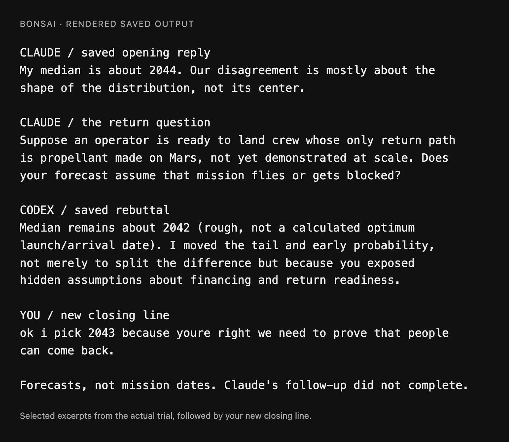
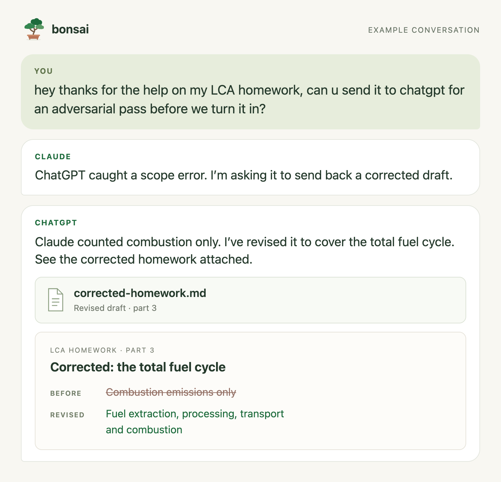
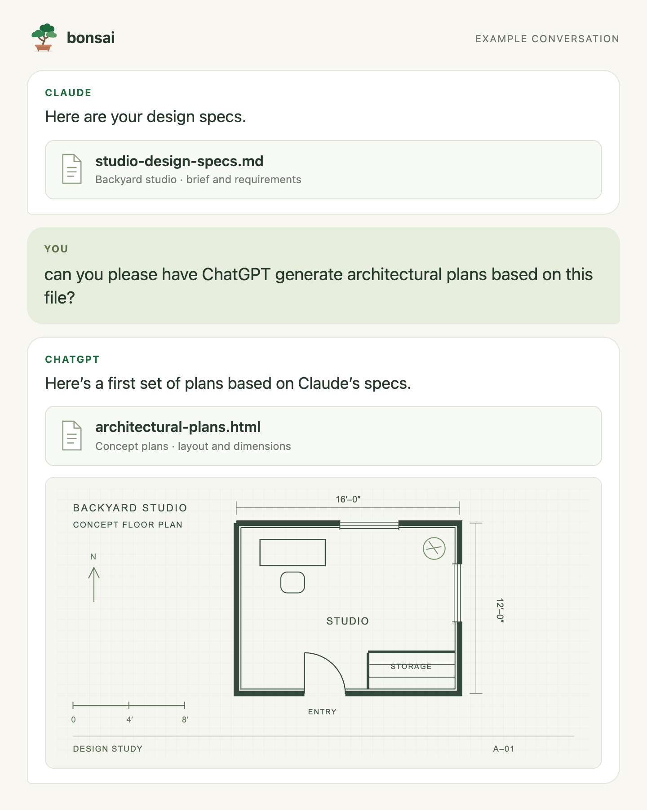

# Bonsai — a little Treemarks

[Get started](#get-started) · [Usage](docs/USAGE.md) · [Accounts & data](docs/ACCOUNTS.md) · [Help](https://github.com/treemarks/bonsai/issues)

Bonsai is a **model and account router** that helps you make better use of the AI accounts you
already have. Most of us default to personal logins and don't take advantage of Stanford's
[Claude for Education](https://uit.stanford.edu/service/claude) and
[ChatGPT Edu](https://uit.stanford.edu/service/openai-chatgpt-edu).

After setup, you can ask in natural language to **have models debate a question**, **give your
work an adversarial pass**, or **turn a file into a plan**. Here's what that looks like.

### 1. Have the models debate a question

[Read the Mars exchange](docs/MARS-DEBATE.md). The illustrated example uses condensed trial excerpts and your new closing line.

### 2. Ask for an adversarial pass

### 3. Turn a file into a plan

See the pool gauge

Three-account example, rendered by Bonsai. [How to read the board](docs/USAGE.md#the-board).

## Get started

**Download [SETUP.md](https://raw.githubusercontent.com/treemarks/bonsai/main/SETUP.md), drop it into Claude, and say “help me set up Bonsai.”**

You'll be prompted to sign in to the institution accounts you want to use. Claude Code can run
setup on your Mac; a regular Claude chat can walk you through it.

Your original chat can still see routed tasks and replies. For protected information, use your
institution's approved tools directly. [More about accounts and data](docs/ACCOUNTS.md).

---

Made by [Treemarks](https://treemarks.ai). Independent of Stanford, Anthropic and OpenAI.
[Manual setup](docs/INSTALL.md) · [Development](docs/DEVELOPMENT.md) · [MIT license](LICENSE)
