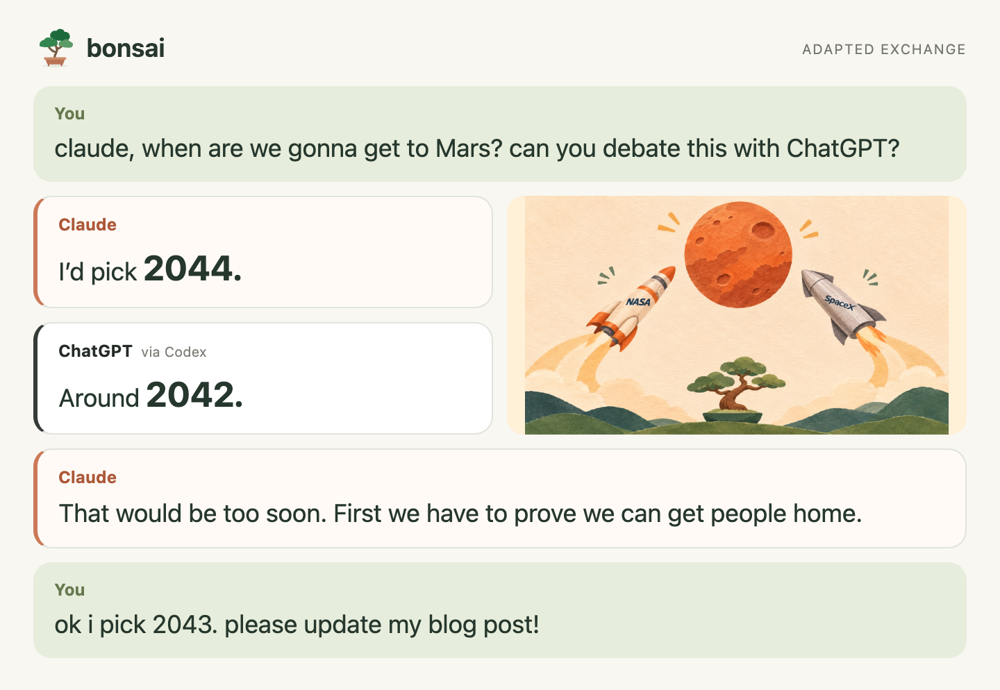
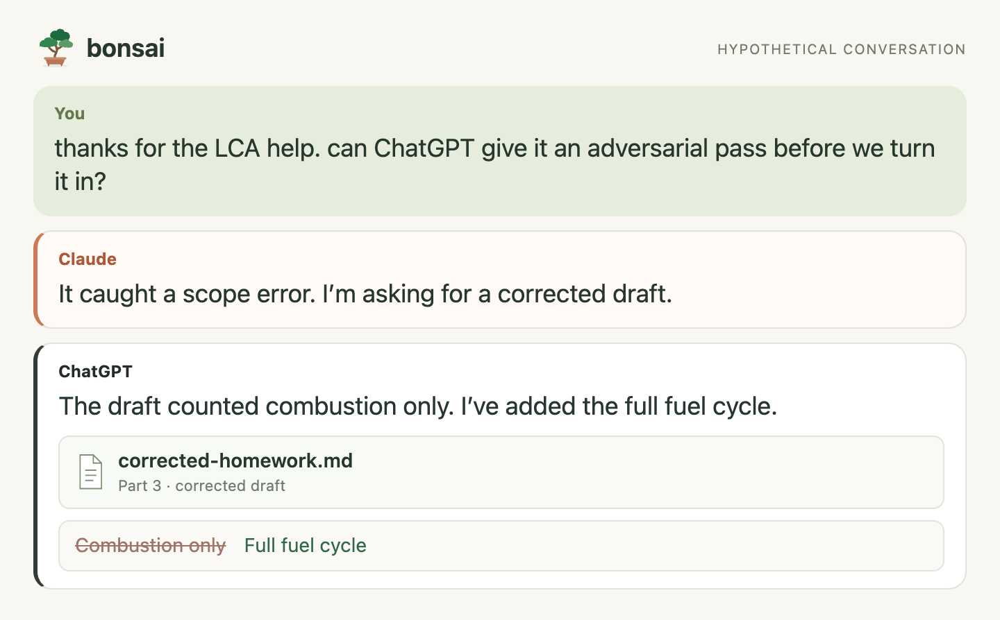
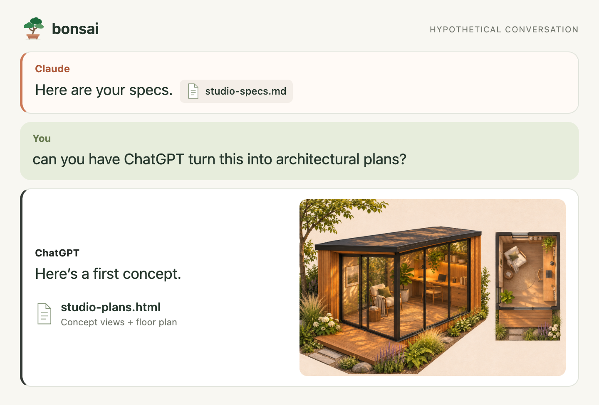
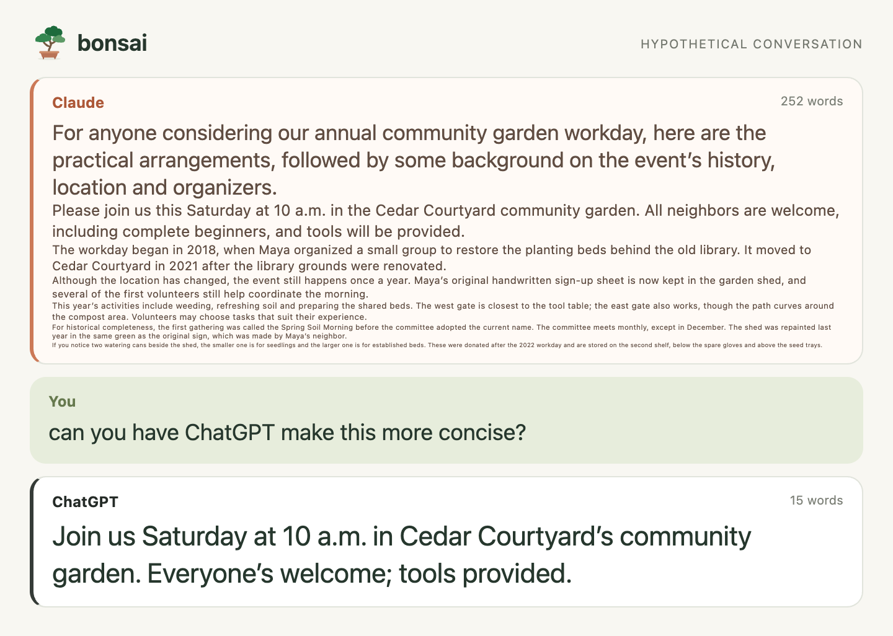
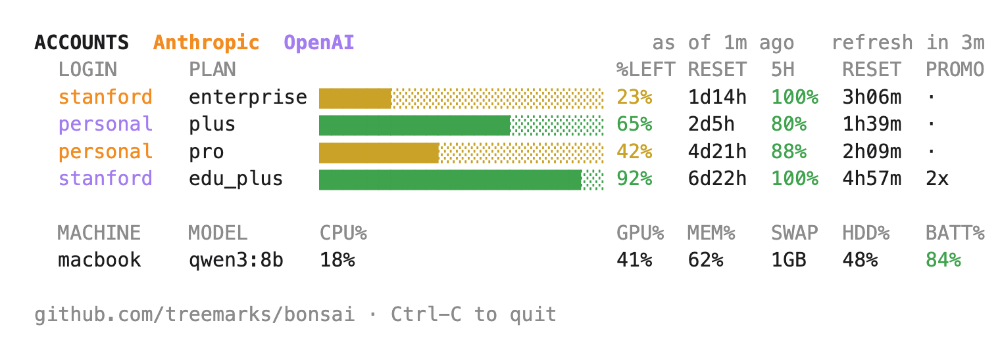

# Bonsai — a little Treemarks

[Get started](#get-started) · [Usage](docs/USAGE.md) · [Accounts & data](docs/ACCOUNTS.md) · [Help](https://github.com/treemarks/bonsai/issues)

Bonsai is a **model and account router** that helps you make better use of the AI accounts you
already have. Most of us default to personal logins and don't take advantage of Stanford's
[Claude for Education](https://uit.stanford.edu/service/claude) and
[ChatGPT Edu](https://uit.stanford.edu/service/openai-chatgpt-edu).

After setup, you can prompt in natural language to **have models debate a question**, **give your
work an adversarial pass**, **turn a file into a plan**, or **reword something verbose**.
Here's what that looks like.

### 1. Have the models debate a question

[Adapted from a recorded Mars debate](docs/MARS-DEBATE.md).

### 2. Ask for an adversarial pass

### 3. Turn a file into a plan

### 4. Reword something verbose

`bonsai gauge`, with sample figures. [How to read it](docs/USAGE.md#the-board).

## Get started

**Download [SETUP.md](https://raw.githubusercontent.com/treemarks/bonsai/main/SETUP.md), drop it into Claude, and say “help me set up Bonsai.”**

You'll be prompted to sign in to the institution accounts you want to use. Claude Code can run
setup on your Mac; a regular Claude chat can walk you through it.

Your original chat can still see routed tasks and replies. For protected information, use your
institution's approved tools directly. [More about accounts and data](docs/ACCOUNTS.md).

**_Currently only tested on Mac OS. Looking for testers for Windows, please let us know your results if you try it!_**

---

Made by [Treemarks](https://treemarks.ai). Not affiliated with or endorsed by Stanford, Anthropic or OpenAI.
Claude and ChatGPT are trademarks of their respective owners.
[Manual setup](docs/INSTALL.md) · [Development](docs/DEVELOPMENT.md) · [MIT license](LICENSE)
