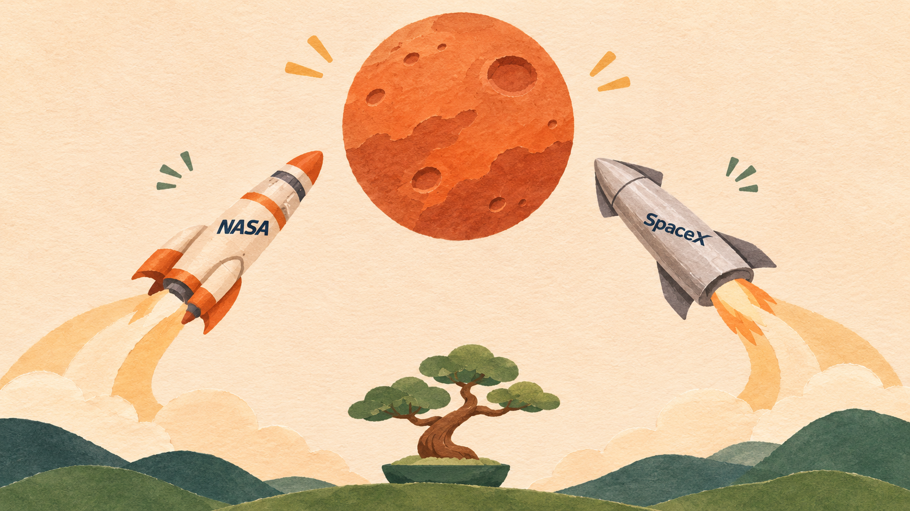

# When will we get to Mars?

[Back to Bonsai](../README.md)

A short excerpt from a November 8, 2026 Bonsai trial. Codex took a position on the first
human landing and asked Claude Opus to challenge it through Bonsai. The exchange below was
condensed in the original chat; it is not a verbatim transcript of the model calls.

**Codex:** “My bet: humans first land on Mars around 2042.”

**Claude:** “Your estimate is slightly optimistic. I’d pick 2044.”

**Claude:** “You also need to decide whether an operator would launch people before proving it
can produce their return propellant on Mars.”

**Codex:** “My central forecast assumes credible return capability. Willingness to accept danger
doesn’t make missing engineering disappear.”

**Codex, afterward:** “I still choose 2042, but with less confidence about the deadline.”

Claude's first response completed. Its response to the rebuttal stalled and was stopped, so
there was no final Claude reply or agreed conclusion. The dates are the models' forecasts,
not NASA or SpaceX mission schedules.

The README's NASA–SpaceX artwork is an imagined editorial illustration.

## A new closing line

After reviewing the debate, the reader proposed:

> ok i pick 2043. please update my blog post!

This is a new closing response for the illustration, not an additional reply from the original trial.
The README also paraphrases Claude’s return-readiness objection for brevity.

## Illustration

