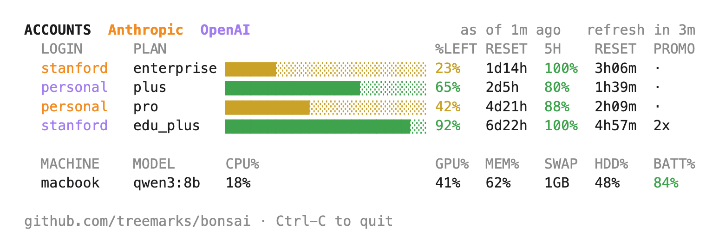

# Using Bonsai

[Home](../README.md) · [Setup](../SETUP.md) · [Usage](USAGE.md) · [Accounts & data](ACCOUNTS.md)

**Start with your agent.** After setup, use Claude Code (the **Code** tab of the Claude desktop app, or `claude` in Terminal) or Codex. Ask in words; the Bonsai skill turns your request into a command. You can name an account, ask another model to review your work, or check how much usage remains.

**Things to say:**

- “Route this to my stanford codex.”
- “Ask astra whether the proof holds.”
- “Have the other model critique this draft.”
- “Debate this with sol.”
- “Show my board.”
- “Update bonsai.”

**Your answers.** Your agent reads the answer and replies in the chat, naming the model that answered. The full text is saved under `~/Bonsai/` if you want it.

## The board



- **Bar and %LEFT:** How much of your weekly limit you have left.
- **Name on the left:** The account’s name.
- **5H and its RESET:** How much of your five-hour limit is left and how long until it resets. A `-` means the account has no five-hour limit.
- **RESET after %LEFT:** How long until your weekly limit resets.

**Choosing an account.** Jobs go to the login you name, such as `stanford-codex` or `personal-claude`, or to one picked automatically. The `prefer` setting steers that automatic choice:

```bash
bonsai config --set prefer=soonest      # Default: the login whose usage limit resets soonest.
bonsai config --set prefer=institution  # Institution accounts first, then the rest.
bonsai config --set prefer=personal     # Personal accounts first, institution accounts when those run out.
```
Stanford's own pages say its seats are for the university's teaching and research mission,
ordinary low-risk work included, so a student doing coursework may want `prefer=institution`.
`personal-codex` and `personal-claude` still name the personal login when you mean it.

**Sending a job.** Ask your agent to send a question or include a draft or notes. For example, this sends notes to your named account and saves the answer:

```bash
bonsai job stanford-codex -f notes.md -o ~/Bonsai/themes.md "Summarize the themes in these notes"
```

**What jobs do.** A routed job produces an answer. It can review an argument, summarize notes, or write a concept plan. Ask your agent for a follow-up job with the draft and review findings if you want a corrected draft.

**Second opinions.** Ask for an adversarial pass to get a second model’s critique, with the most serious findings first, what held up, and a verdict; use a different model family from the draft’s author.

**Debates.** Ask your agent to debate with another model: they exchange critiques and replies in a saved transcript, then your agent explains what it accepts and rejects.

**Web searches.** ChatGPT jobs with `--web` may search the web; these jobs cannot include files.

**Stopping work.** `bonsai jobs` shows running jobs and their results; `bonsai cancel <id>` stops a job.

**Teach your agent.** Run `bonsai install-skill`, then quit and reopen your agent to load it. Read the skill once to understand how it handles your requests.

**Your data.** Routed material is still seen by your chat. The skill refuses material you identify as protected, but does not detect protected information itself. Read [Accounts & data](ACCOUNTS.md); for university data, have someone in your unit review the skill first; Stanford asks that of
repeatable AI workflows and skills.

**Using Codex.** When Codex asks, approve running Bonsai outside its sandbox so the job can start.

**Updates.** The board says when a new version is out. Run `bonsai update`: it shows what changed and asks before changing anything; then run `bonsai install-skill` and reopen your agent.
